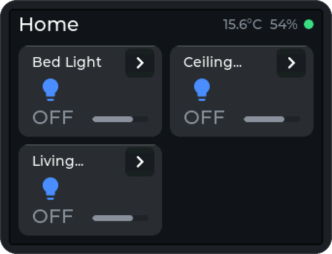
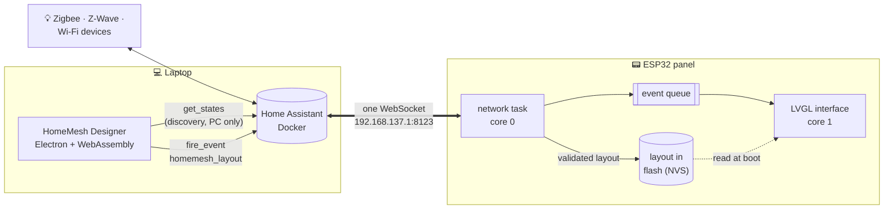
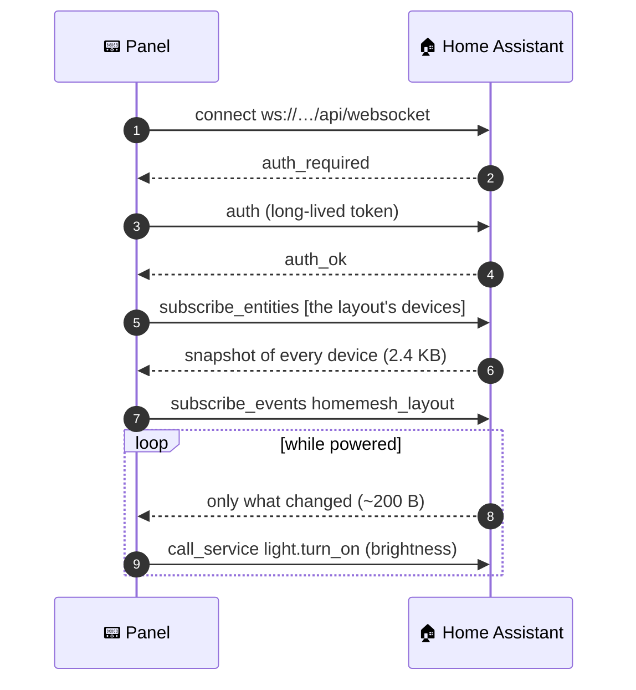
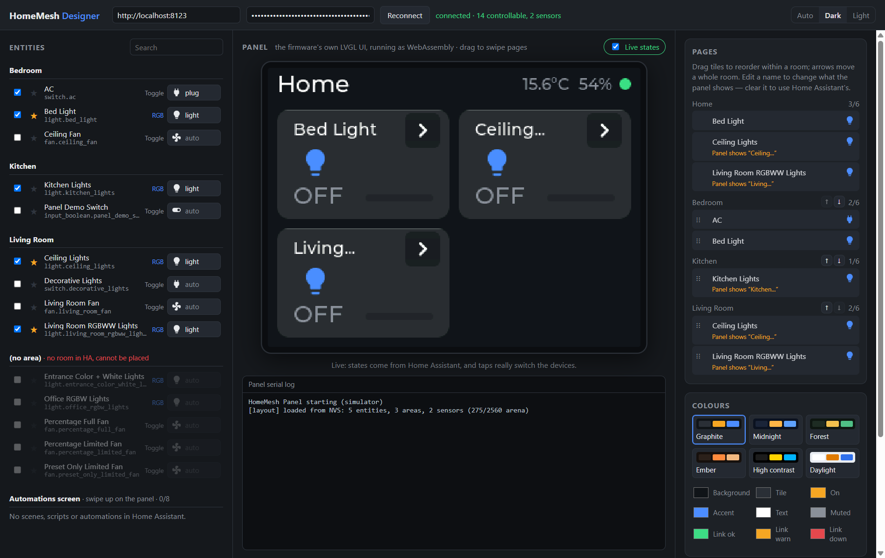
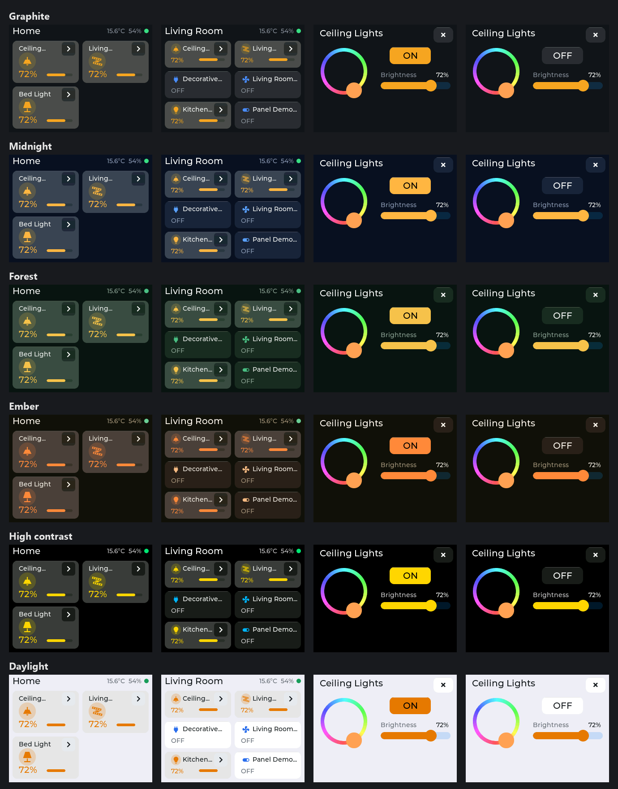
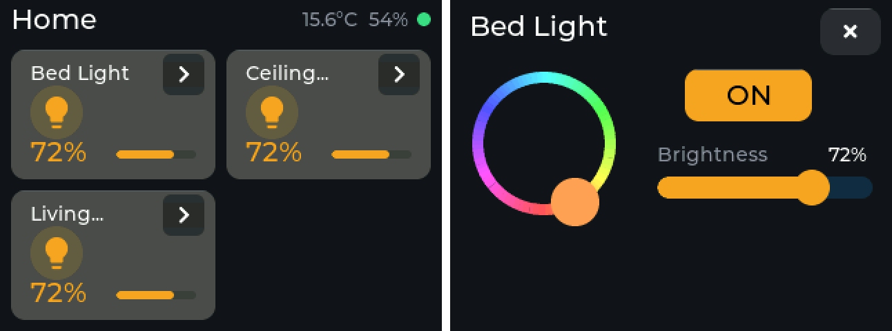

<div align="center">

# HomeMesh Panel

### A wall-mounted touchscreen for every device in your home, running on a microcontroller, with no cloud anywhere in the path.

<p>


</p>
<p>


</p>

<br>



<sub>The panel's own interface code, rendered pixel for pixel by the designer's simulator: lights on, swipe through the rooms, open a light.</sub>

<br><br>

[**How it works**](#how-it-works) · [**The designer**](#the-designer) · [**Getting started**](#getting-started) · [**Engineering notes**](#engineering-notes) · [**Paper**](docs/paper/HomeMesh_IEEE_Paper.pdf) · [**Team**](#team)

</div>

<br>

## Why

Switching on a light through a phone app means unlocking a phone, finding the app and waiting for it to connect, which is slower than the wall switch it replaced. Commercial wall panels fix that, but they are expensive, tied to one manufacturer, and often stop working when the internet does.

**HomeMesh** is a 3.2-inch touch panel built on an ESP32 that talks to a local [Home Assistant](https://www.home-assistant.io/) server. Through Home Assistant it reaches every device in the house: Zigbee, Z-Wave, Wi-Fi or software-only.

<table>
<tr>
<td width="33%" valign="top">

### 🏠 Every device
One WebSocket connection to Home Assistant reaches every entity, whatever integration created it. One `call_service` message controls all of them.

</td>
<td width="33%" valign="top">

### 🔄 Both directions
Change a light anywhere in the house and the panel follows within milliseconds. State is pushed, never polled.

</td>
<td width="33%" valign="top">

### 🎨 Designed, not flashed
Pages, devices, names, icons and colours are authored in a desktop app and sent over the network. No cable, no reflash.

</td>
</tr>
<tr>
<td valign="top">

### 🧠 Fits in 40 KB
The full state of even a small home is bigger than the panel's graphics memory. So the PC discovers and the panel only subscribes.

</td>
<td valign="top">

### ⚡ Never stutters
Networking and the interface run on separate CPU cores, joined by a queue. Swiping stays smooth while the network is busy.

</td>
<td valign="top">

### 🔒 Local first
No cloud account, no vendor app, no internet. The demo runs on a laptop hotspot.

</td>
</tr>
</table>

## By the numbers

<div align="center">

| | |
|:--|--:|
| Full state of a 123-entity Home Assistant install (`get_states`) | **57,671 B** |
| What the panel receives for its 7 devices (`subscribe_entities`) | **2,403 B** · *24× smaller* |
| A state change on the wire | **144 – 262 B** |
| Command → state change inside Home Assistant (median of 10) | **3.2 ms** |
| Panel round trip over the hotspot | **40 ms**, 0% loss |
| Graphics memory free after the first full draw | **15.6 KB** of 40 KB |
| Flash used | **38%** of 3 MB |

</div>

<sub>All measured on the running system, 18 October 2026.</sub>

## How it works

The work is deliberately **split across two machines**. The ESP32-WROOM-32 has no external RAM, and asking Home Assistant for everything returns more data than the panel's whole graphics memory. So:



- **The PC does discovery.** The designer reads every entity, you choose the handful the panel shows, and it sends the result as a ~700-byte layout through Home Assistant's own event bus. The panel needs no web server, and nobody ever needs its IP address.
- **The panel only subscribes.** It asks for exactly the entities in its layout. What it receives grows with the layout, not with the size of the house.
- **A layout is data.** The panel validates it in full *before* storing anything, keeps it in flash, and restarts into it. If none was ever pushed, a layout compiled into the firmware takes over, so a fresh board still comes up working.

### The whole protocol

From the panel's side, an entire smart home reduces to five messages on one connection:



## The designer

<div align="center">

</div>

<br>

The preview in the middle **is not a mock-up**. It is the panel's own firmware UI (`dashboard.cpp`, LVGL 8.3, the icon fonts and the layout validator) compiled to WebAssembly with Emscripten. Same pixels, same fonts, same 16-bit colour, same 40 KB memory pool. If the simulator rejects a layout, the panel would too, with the same message.

| | |
|---|---|
| 🧩 **Pick & arrange** | Tick devices, star favourites for the Home page, drag tiles to reorder or onto another page |
| 📄 **Your own pages** | Pages default to Home Assistant rooms, but you can add, rename and remove them, and place devices that have no room at all |
| ✏️ **Rename** | Shorter names for the panel, with the exact cut LVGL will make shown as you type (`Ceiling…`) |
| 🎨 **Six themes** | Graphite, Midnight, Forest, Ember, High contrast, Daylight, or any of nine colours by hand |
| 🔴 **Live mode** | The simulated panel shows real states, and tapping it really switches your devices |
| 🚀 **Push** | One click sends the layout. The panel restarts into it in a few seconds |
| 📦 **Portable** | Ships as a single `.exe`, with nothing to install |

<details>
<summary><b>🎨 All six themes, on the real UI</b></summary>
<br>
<div align="center">

</div>
</details>

<details>
<summary><b>💡 Tiles and the detail panel</b></summary>
<br>
<div align="center">

</div>

A lit tile lifts a shade, and its icon and reading turn amber; a dimmed light shows its level rather than "ON". The chevron opens on/off, brightness and a colour wheel. Icons are Material Design glyphs compiled into fonts: 7.6 KB of flash and none of the graphics memory.
</details>

## Hardware

<div align="center">

| | Part | Notes |
|---|---|---|
| **Board** | Probots ESP32-2432S032 | 3.2" "Cheap Yellow Display" family |
| **MCU** | ESP32-WROOM-32 | Dual core, 240 MHz, **no PSRAM**, 2.4 GHz Wi-Fi only |
| **Display** | ST7789V, 240×320 IPS | SPI at 27 MHz, used in landscape |
| **Touch** | Goodix GT911 | Capacitive, I²C at 0x5D |
| **USB** | CH340 | Flashing and the serial log |

</div>

This board family ships with **different display and touch controllers from batch to batch**. Both were identified by testing, and all hardware detail lives in two driver files, so nothing above them depends on which batch you have.

## Tech stack

<div align="center">

| Panel firmware | Desktop designer | Infrastructure |
|---|---|---|
| C++ / Arduino on FreeRTOS | Electron | Home Assistant in Docker |
| LVGL 8.3 (pinned) | React 19 + TypeScript | Windows Mobile Hotspot, 2.4 GHz |
| TFT_eSPI | Vite | `tools/preflight.ps1` demo checks |
| arduinoWebSockets + ArduinoJson | Emscripten → WebAssembly | Python reference tools |
| PlatformIO | Node test suite | |

</div>

## Getting started

<details open>
<summary><b>Flash the panel</b></summary>

```bash
# include/secrets.h holds Wi-Fi, the Home Assistant address and a token (gitignored)
pio run -e ha -t upload -t monitor
```

A healthy boot ends with:

```
[layout] loaded from NVS: 5 entities, 3 areas, 2 sensors (275/2560 arena)
[wifi] connected, IP 192.168.137.121, RSSI -46 dBm, modem sleep off
[ha] authenticated
[ha] subscribed to 7 entities
[ha] initial state: 7 entities in one 2403-byte frame
```
</details>

<details>
<summary><b>Run the designer</b></summary>

```bash
designer\HomeMesh Designer.cmd          # first run installs and builds
# or
cd designer && npm install && node node_modules/electron/install.js && npm run build && npm start
# a portable exe:
npm run dist                            # release/HomeMesh Designer <version>.exe
```

It reads `tools/.env` (`HA_URL`, `HA_TOKEN`) and the layout in `include/`. See [`designer/README.md`](designer/README.md).
</details>

<details>
<summary><b>Before a demo</b></summary>

```powershell
powershell -ExecutionPolicy Bypass -File tools\preflight.ps1
```

Checks that the Wi-Fi card is pinned to 2.4 GHz, that the hotspot, the firewall path and the Home Assistant container are up, that the token is valid, and that every device in the layout still exists. It names the fix for anything that fails.
</details>

<details>
<summary><b>Tests</b></summary>

```bash
cd designer && npm test     # designer output == tools/ha_discover.py, byte for byte; name cuts == LVGL
```
</details>

## Engineering notes

The decisions worth knowing about, and the bugs that taught them.

<details>
<summary><b>Why not MQTT?</b></summary>
<br>

The first version spoke MQTT. But MQTT only reaches devices that publish themselves to a broker. **The same physical Zigbee bulb** is reachable if it was added through Zigbee2MQTT and invisible if it was added through ZHA. Coverage that depends on how each device happened to be set up is not a product. Home Assistant's WebSocket API reaches every entity uniformly.
</details>

<details>
<summary><b>Why does the panel restart when a layout arrives?</b></summary>
<br>

Tearing down a screen's worth of LVGL objects and building another fragments the fixed 40 KB graphics pool, and running out of it freezes the screen. A restart takes a few seconds and always works.
</details>

<details>
<summary><b>The bug that looked like flaky firmware</b></summary>
<br>

For days the panel lost its connection at random. Two problems were stacked:

1. The firmware fetched each device's state with a **blocking HTTP request inside the WebSocket's own message handler**. When those were slow, the heartbeat couldn't run, the socket dropped, and the cycle repeated. Fixed by taking state from the subscription itself.
2. Once the panel logged *why* it failed, it said `reason 201 (NO_AP_FOUND)`. The laptop's **single-radio Wi-Fi card dragged the hotspot onto 5 GHz** whenever the router moved the laptop there, and the ESP32 can't see 5 GHz. Fixed by pinning the card to 2.4 GHz.

Firmware that names its failures turned a days-long mystery into a one-session diagnosis.
</details>

<details>
<summary><b>Smaller lessons</b></summary>
<br>

- **Static RAM, not total RAM, is the ceiling.** The build report said 37%, but the linker's data segment had about 1.5 KB to spare. A 48 KB graphics pool would not link.
- **A 4 KB JSON buffer on a 12 KB stack** crashed inside an unrelated `printf`, because the compiler had inlined it into the per-message handler.
- **Fixed-size JSON filters drop keys silently.** Layout pushes vanished with no error, so every message is now classified on its raw bytes before parsing.
- **Gradients band on RGB565.** With 32 levels of red and blue, a subtle ramp shows as tinted stripes, so fills are flat.
- **LVGL's default theme turns checked-button text white**, which made names vanish on light themes. Found by rendering every preset in the simulator.
</details>

## Repository

```
src/          panel firmware: drivers, Home Assistant client, layout store, LVGL UI
include/      lv_conf.h and the compiled-in fallback layout
designer/     the desktop designer (Electron, React, TypeScript)
sim/          builds the firmware's UI to WebAssembly for the designer
tools/        discovery and layout format (reference), preflight checks
docs/         IEEE paper, project documentation, and the scripts that draw every figure
ha/           how the Home Assistant instance is run
```

📄 [**IEEE paper**](docs/paper/HomeMesh_IEEE_Paper.pdf) · 📘 [**Project documentation**](docs/HomeMesh_Panel_Project_Documentation.pdf) · 🧭 [`CLAUDE.md`](CLAUDE.md) (full project notes, hardware details and known traps)

## Team

<div align="center">

| | Member | Role |
|:--:|---|---|
| 🧭 🔌 | **Pranesh S** | Team lead · hardware and firmware architecture |
| 🎨 | **Garima Nidhi** | UI/UX lead · panel interface and the designer app |
| 🏠 | **Taniska Routray** | Home Assistant, protocol and networking |
| 🧪 | **Bharadhwaj B** | Testing, research and documentation |

Faculty guide: **Suhasini S**

CSE3006 Embedded System Design · Vellore Institute of Technology, Chennai

</div>
